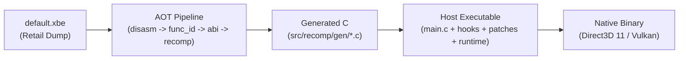

# Xbox Game Static Recompilation Playbook

This skill provides the comprehensive architecture, pipeline procedures, and bring-up troubleshooting loop for porting original Xbox (2001) games to native modern platforms (Windows, macOS, Linux, Steam Deck) via ahead-of-time (AOT) static recompilation using `xboxrecomp`.

---

---

## Bundled References
When working through a bring-up or troubleshooting specific issues, refer to the following companion guides:
- [Bring-Up Checklist (S0 to S4)](references/bringup-checklist.md): Step-by-step verification checklist from binary extraction to a stable game loop.
- [Common Troubleshooting Patterns](references/troubleshooting-patterns.md): Concrete diagnostics and fixes for ICALL failures, MSVC C11 atomics, gamepad input traps, DSP audio hangs, pushbuffer fence spins, and arithmetic bugs.
- [Controller & Input Subsystem Guide](references/controller-input-guide.md): Complete guide for modern gamepad input (Xbox, Bluetooth X3, DualSense), `p1_device = "auto"`, digital vs analog mode switching, and `input.ini` mappings.

## Bundled Scaffolding Tools
- [Xbox Port Scaffolder](scripts/scaffold-new-port.py): Pure-Python CLI tool to generate a full C/CMake project scaffold from an Xbox `default.xbe`.
- [PS1/PSX Port Scaffolder](scripts/scaffold-psx-port.py): CLI tool to parse PS-X EXE binaries, auto-generate `game.toml` with gamepad auto-detection, and produce hardened CMake configurations.

## 1. Core Architecture & Mental Model

Static recompilation translates 32-bit x86 Xbox machine code into native C source code **ahead-of-time (AOT)**, which is then compiled into a native 64-bit binary by MSVC, Clang, or GCC.



### Essential Principles:
1. **Direct Execution:** Guest code runs directly as compiled native functions (`sub_XXXXXXXX`).
2. **Global Register File in TLS:** Guest registers (`g_eax`, `g_ecx`, `g_edx`, `g_esp`, `g_ebx`, `g_esi`, `g_edi`, FP stack, XMM) must reside in **Thread-Local Storage (`RECOMP_TLS`)** so multi-threaded guest code doesn't clobber registers.
3. **Flat Virtual Memory Offset (`g_xbox_mem_offset`):**
   Guest memory access is translated via macros:
   `MEM8(va)  = *((uint8_t  *)(g_xbox_mem_offset + va))`
   `MEM16(va) = *((uint16_t *)(g_xbox_mem_offset + va))`
   `MEM32(va) = *((uint32_t *)(g_xbox_mem_offset + va))`
4. **Hardware-Level Translation, Not High-Level API Hooking:**
   Xbox games statically link the Xbox Development Kit (XDK) libraries (D3D8, DSOUND). You **do not** hook high-level D3D APIs. You lift the statically linked library code and intercept the low-level **NV2A pushbuffer command stream** and **APU/AC97 MMIO registers**.

---

## 2. Recompilation Pipeline (AOT Steps)

Always run the pipeline in strict order. In this project, [pipeline-state.py](file:///c:/Project/DefJamFFNY-recomp/scripts/pipeline-state.py) enforces input/output hashing so stale steps are rejected.

### Step 1: Dump Verification & XBE Inspection
1. Parse the XBE header:
   ```bash
   python -m tools.xbe_parser game/default.xbe --json game_files/default_analysis.json
   ```
2. Note the critical parameters:
   - **Base Address:** usually `0x00010000`
   - **Entry Point VA:** e.g., `0x001F6357`
   - **Section Table:** Identify code sections (`.text`, and XDK sections: `D3D`, `D3DX`, `DSOUND`, `XPP`, `XGRPH`, `DOLBY`).

### Step 2: Disassembly (`tools.disasm`)
> [!IMPORTANT]
> **Never skip XDK library sections.** Xbox games embed crucial code inside non-`.text` sections. Passing `--text-only` will cause massive ICALL failures into missing functions.

```bash
python -m tools.disasm game_files/default.xbe --force \
    --extra-sections D3D,D3DX,DSOUND,XPP,XGRPH,DOLBY \
    --seed-functions config/seed_functions.json
```

### Step 3: Function Identification & ABI Recovery
1. Identify routine boundaries:
   ```bash
   python -m tools.func_id game_files/default.xbe -v
   ```
2. Recover calling conventions and stack balance:
   ```bash
   python -m tools.abi_analysis game_files/default.xbe -v
   ```
   *Identifies `cdecl`, `stdcall`, `fastcall`, `thiscall`, parameter count, and callee-saved registers (`ebx`, `esi`, `edi`, `esp`).*

### Step 4: C Code Generation (The Lifter)
Translate assembly blocks into C functions:
```bash
python -m tools.recomp game_files/default.xbe --all \
    --split 1000 \
    --gen-dir src/recomp/gen \
    --exclude-manual src/recomp_manual.c
```
- `--split 1000`: Splits functions into files with ~1000 functions each (`recomp_0001.c`...) to prevent compiler heap exhaustion (`/bigobj`).
- `--exclude-manual`: Reads `src/recomp_manual.c` and excludes manually overridden functions from generation.
- Generates `recomp_dispatch.c` for O(1) flat dispatch table lookup of indirect calls.

---

## 3. Host Architecture & Bootstrapping (`src/main.c`)

The host entry point must execute this initialization sequence:

1. **Memory Allocation:**
   Allocate 64 MB (or 128 MB debug RAM) + hardware aperture mirrors with `xbox_MemoryLayoutInit(xbe_data, xbe_size)`. Set `g_xbox_mem_offset = xbox_GetMemoryOffset()`.
2. **Install Vectored Exception Handler (VEH / Signal Handler):**
   Install before any guest code runs:
   - Intercept hardware MMIO addresses (APU `0xFE800000`, OHCI USB, AC97 `ac97_bm`, NV2A clock/cache flush).
   - If a crash occurs: decode registers, resolve host RIP to `sub_XXXXXXXX` symbol via PDB / `dbghelp`, and scan guest stack `[esp+N]` for valid code VAs.
3. **Kernel HLE Initialization:**
   Call `xbox_kernel_init()` and `xbox_kernel_bridge_init()`.
   Initialize virtual path translations:
   - `D:\` -> Game directory
   - `T:\`, `U:\` -> Persistent user data & save directories
4. **Emulated Devices Setup:**
   - Stand up D3D11 / Vulkan swapchain via `d3d11_translator_init()`.
   - Initialize APU & AC97 bus master: `mcpx_apu_init_standalone()`, `ac97_bm_init()`.
   - Set AC97 codec ready bit: `RECOMP_AC97_READY=1`.
5. **Stack Initialization & Launch:**
   - Initialize `g_esp = XBOX_STACK_TOP` (usually `0x00010000` or top of stack section).
   - Arm watchdog timer: `xbox_WatchdogStart()`.
   - Call recompiled entry point: `xbe_entry_point()`.

---

## 4. The Bring-Up & Triage Loop (S0 to S4)

Evaluate booting progress using cumulative stages:
- **S0:** Process starts, XBE loaded into memory.
- **S1:** Memory layout & kernel replacement bridge initialized.
- **S2:** Guest entry called without crashing in the first 5 seconds.
- **S3:** Graphics device initialized, first pushbuffer frame presented.
- **S4:** Stable execution loop without crash or hang.

### Diagnosing Stops with `triage.py`:
Run `python scripts/triage.py` to digest logs. Look at the verdict:
- **`clean`:** Frame reports presenting normally.
- **`explained`:** Stop signature identified (`[CRASH]`, `[ICALL] Failed to resolve`, `[WATCHDOG]`).
- **`partial` / `unexplained`:** Inspect sliced lines:
  ```bash
  python scripts/triage.py LOG --around <line> --context 30
  ```

### Resolving Missing Indirect Calls (ICALLs):
When the guest crashes with:
`[ICALL] Failed to resolve VA 0x00XXXXXX`
1. Run:
   ```powershell
   .\scripts\seed-from-log.ps1 -Log logs\run-latest.log
   ```
2. Verify that `config/seed_functions.json` captured the VA.
3. Re-run `analyze.ps1` -> `recomp.ps1` -> `build.ps1`.

---

## 5. Overrides & Hooking Patterns

### Overriding Lifter Bugs or Broken Logic (`src/recomp_manual.c`)
Write the replacement function directly:
```c
void sub_00123450(void) {
    // 1. Read parameters off guest stack
    uint32_t arg1 = MEM32(g_esp + 4);
    uint32_t arg2 = MEM32(g_esp + 8);

    // 2. Perform custom logic
    uint32_t result = custom_c_implementation(arg1, arg2);

    // 3. Set return value
    g_eax = result;

    // 4. Pop return address and clean stack (__stdcall or __cdecl)
    // For cdecl: g_esp += 4;
    // For stdcall with 2 args: g_esp += 4 + 8;
    g_esp += 12;
}
```

### Bracketing & Entry Hooks:
To observe or manipulate parameters without rewriting the function:
```c
void sub_00123450_enter(void) {
    uint32_t param = MEM32(g_esp + 4);
    // Custom telemetry or parameter override
}
```

---

## 6. Graphics, Audio & Modern Enhancements

### Widescreen (Hor+) Implementation (`src/patches/widescreen.c`)
1. **3D Projection:** Hook the game's camera aspect ratio function:
   $$\text{FOV}' = 2 \cdot \arctan\left(\tan\left(\frac{\text{FOV}}{2}\right) \cdot \frac{A}{A_0}\right)$$
   Where $A = \text{target aspect}$ (e.g. $16/9$) and $A_0 = 4/3$.
2. **2D Elements Preservation:**
   Separate 3D geometry from 2D ortho quads. Center 2D elements:
   $$x' = 320 + (x - 320) \cdot \frac{A_0}{A}$$
   Anchor HUD left/right elements to viewport edges so widescreen doesn't stretch menus or fonts.

### Hardware MMIO Trapping
When game code reads/writes to unmapped registers (e.g. GPU sync or audio reset):
- Implement a dedicated trap handler in `src/hooks/` (like `nv2a_regs.c` or `ac97_bm.c`).
- In VEH, match the fault VA:
  ```c
  if (nv2a_regs_owns_address(fault_va)) {
      if (nv2a_regs_handle_mmio(ep->ContextRecord, fault_va))
          return EXCEPTION_CONTINUE_EXECUTION;
  }
  ```

---

## 7. QA & Testing Harness Strategy

1. **Determinism Verification:**
   Record inputs per frame and hash internal simulation state (RNG seed, physics coordinates). Compare stream hash across Debug and Release builds.
2. **Golden Frame Signatures (`tests/golden/`):**
   Never commit copyrighted game screenshots to git. Instead, calculate mathematical frame signatures (bounding box, unique color count, pixel checksum) and verify with `frame-signature.py`.
3. **Save Tree Isolation:**
   Always snapshot and restore the `save/` directory during automated test runs so regression tests remain reproducible.

---

## 8. Compiler Toolchain, MSVC Conformance & Platform Shims

When compiling massive recompiled codebases (~500k to 1.5M+ lines of C/C++) on modern platforms (Windows MSVC, Linux GCC, macOS Clang), adhere to these strict toolchain rules:

### A. MSVC C11 Atomics Configuration
MSVC requires explicit enablement of C11 atomic primitives when runtime code includes `<stdatomic.h>`. Without this, MSVC aborts with `#error: "C atomic support is not enabled"`.
In CMake, apply `/experimental:c11atomics` to all C translation units:
```cmake
if(MSVC)
    get_target_property(_all_sources ${target} SOURCES)
    foreach(_src IN LISTS _all_sources)
        if(_src MATCHES "\\.c$")
            set_property(SOURCE ${_src} APPEND PROPERTY COMPILE_OPTIONS /experimental:c11atomics)
        endif()
    endforeach()
endif()
```

### B. Cross-Compiler Atomic Guards (Win32 Interlocked vs GCC Built-ins)
Never use bare GCC/Clang built-ins like `__atomic_store_n` or `__ATOMIC_RELEASE` without MSVC fallbacks. Guard all cross-thread shared states:
```c
#if defined(_WIN32)
    InterlockedExchange((volatile LONG*)&s_shared_state, (LONG)new_val);
#else
    __atomic_store_n(&s_shared_state, new_val, __ATOMIC_RELEASE);
#endif
```

### C. C++17 Strict Conformance in Lambda Closures
In MSVC strict C++17 mode, `static_assert` inside a lambda closure cannot read outer enclosing function `constexpr` local variables (`error C2131: expression did not evaluate to a constant`).
- Re-declare `constexpr` locally within the lambda body, or evaluate compile-time boolean literals directly.

### D. Subprocess Path Hygiene (Spaces in Directories)
Never invoke toolchain subprocesses (such as BIOS lifters, disassemblers, or patchers) using raw unquoted string concatenation. Workspace directories frequently contain spaces (e.g., `C:\Project\Harvest Moon - Back to Nature (USA)`):
- Always pass arguments as separate elements in an argument list (e.g. `subprocess.run(["tool.exe", "--config", path])`).
- When executing sub-binaries in shell/PowerShell scripts, wrap all variable expansions in double quotes: `& "$Tool" --config "$ConfigPath"`.

### E. Split-TU (Translation Unit) Sharding
Always shard monolithic recompiled binaries into 15 to 20 files (`full_00.c` ... `full_19.c`) + a unified dispatch table. This:
- Prevents MSVC compiler heap exhaustion (`C1002`).
- Enables parallel multi-core compilation (`cmake --build build --config Release --parallel`).
- Keeps object file symbols well below the 65,536 limit (pair with `/bigobj` on MSVC).

---

## 9. Universal Static Recompilation Principles (Xbox x86 & Console MIPS / PSX / N64)

While original Xbox games target 32-bit x86 and PlayStation/N64 games target MIPS (R3000A / VR4300), modern static recompilers share the exact same foundational architecture:

| Subsystem | Xbox (x86 - `xboxrecomp`) | PlayStation 1 (MIPS R3000A - `psxrecomp`) | N64 (MIPS VR4300 - `N64Recomp`) |
| :--- | :--- | :--- | :--- |
| **Instruction Decoding** | Variable-length x86 with prefix bytes | Fixed 32-bit MIPS instructions (1 delay slot) | Fixed 32-bit MIPS III / IV instructions |
| **Function Discovery** | `CALL` / `RET` scanning + XDK library sections | `jr $ra` + prologue analysis (`addiu $sp, $sp, -imm`) | `jr $ra` + symbol heuristics |
| **Branch Delay Slots** | None (direct branching) | 1-instruction delay slot emulation | 1-instruction delay slot emulation |
| **Dispatch Model** | Flat direct array / hash dispatch table | Dense 32-bit dispatch table (`psx_unknown_dispatch`) | Binary search / direct function table |
| **Kernel / BIOS** | Xbox Kernel HLE bridge (`xbox_kernel_init`) | Retail BIOS (SCPH1001) or OpenBIOS C recompilation | Ultra64 OS syscall replacement |
| **Hardware Shim** | NV2A pushbuffer -> Direct3D 11 / Vulkan | GPU packets + GTE coprocessor -> SDL3 / OpenGL / D3D | RDP display lists -> modern graphics |
| **Audio Subsystem** | APU / AC97 MMIO register trapping | SPU (24 ADPCM voices) + CD-DA audio stream | RCP / RSP audio microcode synthesis |

---

## 10. Graphical Configuration Launcher & Clean Distribution Standards

### A. Standalone Zero-Dependency GUI Launcher (`Launcher.exe`)
Players expect a seamless PC gaming experience before launching a recompiled console port. Provide a dedicated graphical configuration launcher compiled into a tiny, self-contained binary (~25 KB):
- **Zero External Dependencies:** Compile a C# Windows Forms application using Windows' built-in .NET Framework compiler (`C:\Windows\Microsoft.NET\Framework64\v4.0.30319\csc.exe /target:winexe /optimize+ /platform:anycpu`). This ensures immediate execution across all Windows 7, 10, and 11 systems without requiring Python, Visual C++ Redistributables, or third-party frameworks.
- **Configurable Subsystems:**
  1. **Display & Resolution:** Windowed, Borderless Fullscreen, Exclusive Fullscreen, Resolution presets (800x600 up to 4K UHD), and Aspect Ratio toggles (4:3 Classic, 16:9 Widescreen, 21:9 Ultrawide).
  2. **Performance & FPS:** Target refresh rate (30, 60, 120, 144, 240 FPS via `PSX_HOST_REFRESH_HZ`), V-Sync (On/Off/Adaptive), Low-Latency Input, Multi-threaded Render Pipeline, and Fast-Forward multiplier (`PSX_FAST_FORWARD_SPEED`).
  3. **Controls & Gamepad:** Automatic detection (`p1_device = "auto"`), DualShock Analog Stick vs Digital D-Pad selection, and Analog Deadzone sliders (5% to 30%).
  4. **Save Data Management:** One-click shortcut to inspect and backup memory card save files (`card1.mcd`, `card2.mcd`).

### B. Batch File (`.bat`) Hygiene in Windows CMD
When writing friendly launcher batch files (`Play_Game.bat`):
1. **Never use unescaped parentheses inside `if (...)` compound blocks:** If text or file names contain parentheses (such as `Harvest Moon - Back to Nature (USA).cue`), the closing parenthesis `)` will prematurely terminate the CMD parser block, producing cryptic errors like `.cue was unexpected at this time`.
2. **Never place label comments (`::`) inside parentheses:** Use standard `rem` or prefer branching logic with `goto :label` over nested `if (...)` blocks.

### C. Clean-Room Assetless Distribution
Always preserve a strictly legal distribution package:
- Distribute binaries, OpenBIOS/HLE shims, launcher, and configuration files only.
- Exclude copyrighted ISO/BIN/CUE/CHD discs from version control and release zips.
- Provide a dedicated `game/` drop folder with an instructional marker file (`TEMPATKAN_FILE_DISC_DISINI.txt`) for user-supplied game dumps.

