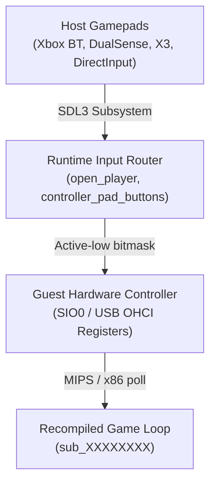

# Controller & Input Subsystem Guide for Static Recompilation

This reference provides the complete architectural guide, configuration reference, and troubleshooting SOP for modern gamepad input (Xbox, Bluetooth X3/DirectInput, DualSense, Switch Pro) in static recompilation runtimes.

---

## 1. Input Architecture & Mental Model

Modern static recompilation runtimes (such as `psxrecomp` and `xboxrecomp`) use **SDL3 / SDL2** to abstract host input hardware and route them to guest hardware controller registers:



### Essential Concepts:
1. **Host Mapping (`input.ini`)**: Translates SDL controller buttons (`a`, `b`, `x`, `y`, `dpup`, `lefttrigger`) to guest active-low button bits.
2. **Device Routing**: Directs a physical SDL joystick/gamepad instance to Player 1 or Player 2 slots.
3. **Controller Mode (`p1_mode`)**:
   - **`digital`**: Emulates the standard original controller (`0x41` on PS1). Left stick directions automatically fold onto the D-Pad.
   - **`analog`**: Emulates the DualShock controller (`0x73` on PS1). Left/Right analog sticks report full 8-bit radial coordinates (`0x00`-`0xFF`, `0x80` centered), and D-Pad bits operate independently.

---

## 2. The Release Build Keyboard Trap

> [!WARNING]
> By default, static recompilation runtime release builds set:
> ```cpp
> #if defined(PSX_DEBUG_TOOLS)
>     player_device[0] = "auto";
> #else
>     player_device[0] = "keyboard"; // Release default!
> #endif
> ```
> If the `[controller]` block is omitted from `game.toml`, `player_device[0]` defaults to `"keyboard"`. In this mode, `open_player()` **never enumerates or opens connected physical gamepads**, and the game will completely ignore all gamepad inputs even if paired properly in Windows.

### The Fix:
Always specify the `[controller]` block in `game.toml`:
```toml
[controller]
p1_device = "auto"      # Automatically open first connected gamepad
p1_mode = "analog"      # "analog" (DualShock) or "digital" (Standard Pad)
deadzone = 3277         # ~10% radial deadzone (0 to 32767 scale)
```

---

## 3. Game Compatibility: Digital vs Analog Mode

Certain classic console games interact differently depending on the controller mode:

| Game Type | Recommended `p1_mode` | Behavior / Rationale |
| :--- | :--- | :--- |
| **Grid / 2D Movement** (e.g. *Harvest Moon: BTN*) | `analog` | Left stick and D-Pad both navigate character. Left stick folds onto cardinal directions. |
| **Pre-DualShock Classics** (e.g. *Mega Man X4*, *Crash 1*) | `digital` | Early games using pre-DualShock libraries silently drop packets from controllers answering `0x73` (DualShock). Setting `digital` restores 100% responsiveness. |
| **Dual-Analog Required** (e.g. *Ape Escape*) | `analog` | Requires independent left and right analog sticks. Digital mode will prevent gameplay. |

---

## 4. `input.ini` Configuration Reference

`input.ini` resides in the same directory as the game executable.

```ini
[controller]
enabled = true
device = 0              ; 0 = first controller, or specific SDL GUID
deadzone = 3277         ; 10% radial deadzone

[mapping]
; Standard Action Buttons
cross = a               ; Xbox A -> PS1 Cross
circle = b              ; Xbox B -> PS1 Circle
square = x              ; Xbox X -> PS1 Square
triangle = y            ; Xbox Y -> PS1 Triangle

; Directional Pad
up = dpup
down = dpdown
left = dpleft
right = dpright

; Shoulder & Triggers
l1 = leftshoulder       ; LB
r1 = rightshoulder      ; RB
l2 = lefttrigger        ; LT (analog thresholded)
r2 = righttrigger       ; RT (analog thresholded)

; Stick Clicks
l3 = leftstick          ; L3
r3 = rightstick         ; R3

; System
start = start
select = back

; Analog Sticks (Radial rescaled)
ls_up = lefty-
ls_down = lefty+
ls_left = leftx-
ls_right = leftx+
rs_up = righty-
rs_down = righty+
rs_left = rightx-
rs_right = rightx+
```

---

## 5. Bluetooth Gamepad Pairing (X3, Ipega, Generic)

For generic Bluetooth gamepads like the **X3 Gamepad**:
1. **Hold `X + Home`**: Boots the controller into **Xbox Wireless Controller / XInput mode**.
2. Windows Bluetooth Settings will identify it as:
   `Xbox Wireless Controller (Status: OK)`
3. Ensure no background mapper (like Steam Input Desktop layout or DS4Windows) is intercepting or suppressing exclusive device handles.
4. Launch the recompiled executable; SDL will automatically bind to the controller.
